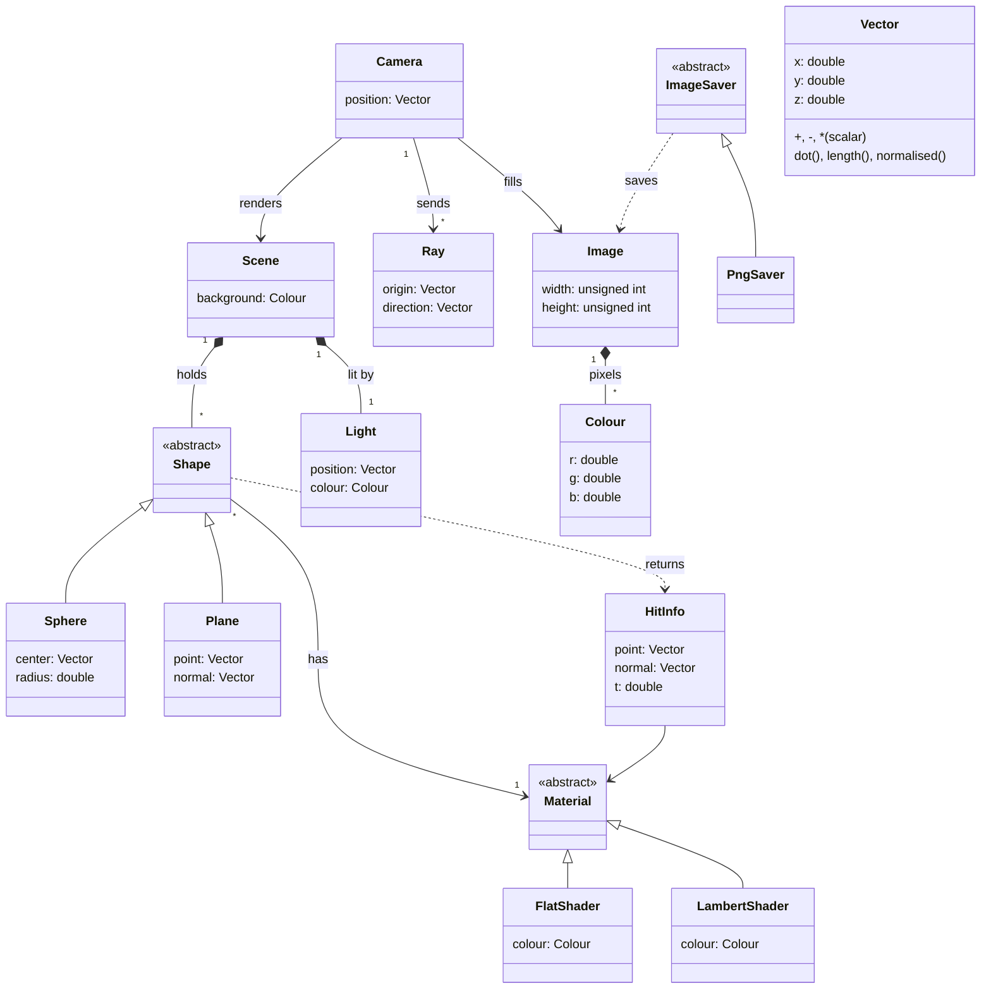

# Domain model

UML class diagram, without methods except for Vector. It uses the client's words: a scene holds shapes and a light, and a camera looks at it.

Notes:

- The camera always looks along the positive Z axis, at a screen placed at distance 1.
- The light is a point light. The sun is a point light placed very far away.
